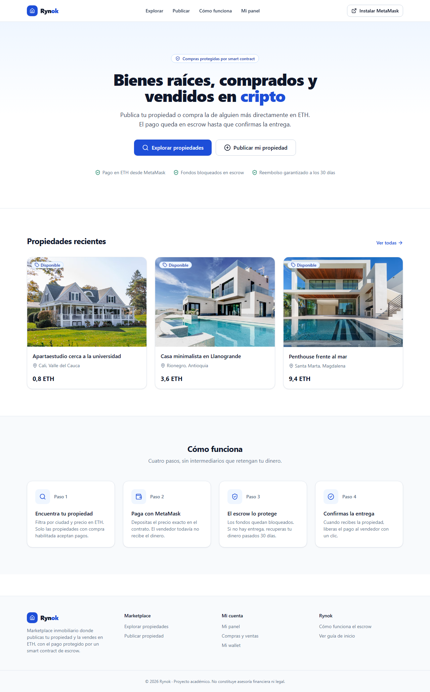
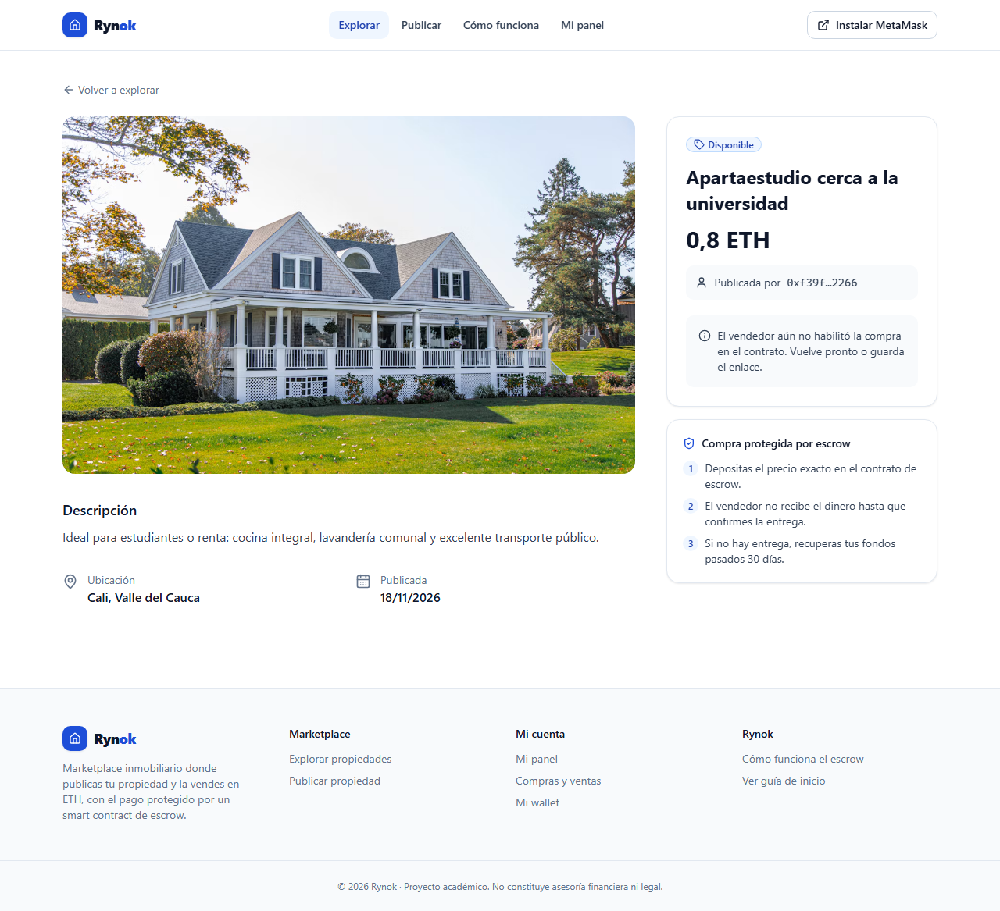
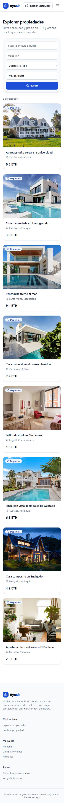

# Rynok

Rynok is a decentralized real estate marketplace that connects property owners and buyers through blockchain-based transactions using Ethereum.

Users sign in with their MetaMask wallet, publish property listings with their own uploaded photos, description, location, and price in ETH, and browse, search, and manage listings. Purchases are paid in ETH and protected by an escrow smart contract deployed on Sepolia: funds stay locked until the buyer confirms delivery, the seller refunds, or the delivery deadline expires.

## Project Status

**All five milestones are delivered.** The escrow contract is deployed and the full purchase flow was validated end to end on the Sepolia testnet. See [Delivery Status](docs/statement_of_work.md#delivery-status) for the full breakdown.

| Milestone                         | Status                                                            |
| --------------------------------- | ----------------------------------------------------------------- |
| M1 — Foundation & Authentication  | Delivered                                                         |
| M2 — Property Marketplace         | Delivered                                                         |
| M3 — Blockchain & Escrow          | Delivered                                                         |
| M4 — Transactions & Documentation | Delivered                                                         |
| M5 — Testing & Finalization       | Delivered (contract deployed on Sepolia, flow validated on-chain) |

### Deployed contract

| Network                             | Escrow address                                                                                                                  |
| ----------------------------------- | ------------------------------------------------------------------------------------------------------------------------------- |
| Ethereum Sepolia (chainId 11155111) | [`0x049BBA8708b71E33f649Bae0E2F127F805ca9Ca9`](https://sepolia.etherscan.io/address/0x049BBA8708b71E33f649Bae0E2F127F805ca9Ca9) |

### Iteration 3.1: demo and defense hardening (branch `mejoras-demo-defensa`)

Built on top of the deployed version without changing the contract:

- **Design system and redesigned UI**: accessible components (WCAG AA contrast, keyboard navigation, focus states, reduced motion), mobile navigation, skeletons, and empty and error states. The brand palette now actually applies (Tailwind v4 was ignoring `tailwind.config.ts`).
- **Purchase UX**: confirmation modals that show the amount, a balance check before signing, wrong-network banner with one-click switch, and automatic re-login when the session expires. If the deposit succeeds but the backend is down, the UI offers to **retry the registration without paying twice**.
- **API hardening**: helmet, CORS restricted by `CORS_ORIGINS`, rate limiting, uniform error format, and `GET /health`. On-chain verification is **fail-closed in production**, and a deposit hash cannot be registered twice.
- **Quality**: server-side pagination and sorting, Playwright browser e2e against the real stack, GitHub Actions CI, Docker images, and Prettier plus strict linting.

| Home                                       | Property detail                                 | Marketplace (mobile)                                    |
| ------------------------------------------ | ----------------------------------------------- | ------------------------------------------------------- |
|  |  |  |

## How a purchase works

1. **Publish**: the seller publishes the property (backend only, no transaction).
2. **Enable purchase**: the seller clicks _Habilitar compra_, which signs `list(propertyId, price)` and sets the exact price on-chain.
3. **Buy**: the buyer clicks _Comprar con MetaMask_ and deposits exactly that price into the escrow. The backend verifies the transaction on-chain before marking the property `IN_ESCROW`.
4. **Close the deal**, in one of three ways:
   - the buyer confirms delivery, and the funds go to the seller (`SOLD`);
   - the seller refunds the buyer (`AVAILABLE` again);
   - after 30 days without confirmation, the buyer reclaims the funds.

Design decisions, security model, and known limitations: [docs/escrow.md](docs/escrow.md).

## Stack

| Layer      | Technology                                                                                                                                            |
| ---------- | ----------------------------------------------------------------------------------------------------------------------------------------------------- |
| Frontend   | Next.js 16 (App Router), React 19, TypeScript, Tailwind CSS v4 design system ([style guide](docs/style_guide.md))                                     |
| Backend    | NestJS, TypeORM, PostgreSQL                                                                                                                           |
| Auth       | Wallet-signature login (MetaMask + `ethers.js`) with single-use nonces and JWT sessions — no passwords                                                |
| Blockchain | Solidity 0.8.24, Hardhat 3, OpenZeppelin (`ReentrancyGuard`), Ethereum Sepolia                                                                        |
| Testing    | Hardhat + Mocha/Chai (contract), Vitest + `supertest` (backend), Vitest + Testing Library (frontend), Playwright (browser e2e against the real stack) |
| API Docs   | Swagger / OpenAPI (`/api/docs`)                                                                                                                       |
| Infra      | Render + Vercel, Docker (PostgreSQL, API and web images), GitHub Actions CI                                                                           |

## Getting Started

Requirements: Node.js 22+, Docker, and MetaMask set to the **Sepolia** network with some test ETH ([faucet](https://www.alchemy.com/faucets/ethereum-sepolia)).

```bash
# 1. Install dependencies (npm workspaces — installs backend + frontend)
npm install

# 2. Start PostgreSQL (exposed on host port 5433 to avoid clashing with a local PostgreSQL)
docker compose up -d postgres

# 3. Configure environment variables
cp backend/.env.example backend/.env
cp frontend/.env.local.example frontend/.env.local
```

Fill in the escrow variables, using the deployed contract above or your own deployment (step 4):

| File                  | Variable                     | Value                                                                                       |
| --------------------- | ---------------------------- | ------------------------------------------------------------------------------------------- |
| `frontend/.env.local` | `NEXT_PUBLIC_ESCROW_ADDRESS` | Escrow contract address                                                                     |
| `frontend/.env.local` | `NEXT_PUBLIC_CHAIN_ID`       | `11155111` (Sepolia) or `31337` (local Hardhat node)                                        |
| `backend/.env`        | `ESCROW_CONTRACT_ADDRESS`    | Same address                                                                                |
| `backend/.env`        | `ESCROW_RPC_URL`             | Sepolia RPC URL (e.g. Alchemy). Enables on-chain verification of every escrow transaction   |
| `backend/.env`        | `JWT_SECRET`                 | A long random string                                                                        |
| `backend/.env`        | `CORS_ORIGINS`               | Allowed web origins, comma-separated (e.g. the Vercel URL). Default `http://localhost:3000` |
| `backend/.env`        | `NODE_ENV`                   | `production` requires `JWT_SECRET` and rejects escrow operations it cannot verify on-chain  |

```bash
# 4. (Optional) Deploy your own escrow contract
cd contracts && npm install
cp .env.example .env              # SEPOLIA_RPC_URL + PRIVATE_KEY of a TEST wallet
npm run deploy:sepolia            # prints the address to put in both .env files
cd ..

# 5. Start the backend and the frontend together
npm run dev

# 6. (Optional) Seed 8 sample properties owned by your seller wallet.
#    DEMO_PRICE_SCALE=0.001 makes them affordable with faucet ETH on Sepolia.
DEMO_SELLER_ADDRESS=0xYourSellerWallet DEMO_PRICE_SCALE=0.001 npm run seed
```

- App: `http://localhost:3000`
- API docs (Swagger): `http://localhost:3001/api/docs`

> To try a purchase you need **two MetaMask accounts** on Sepolia: one for the seller and one for the buyer. Switching accounts in MetaMask signs you out of Rynok, so you can connect again with the other account.

## Deployment

The contract is already on Sepolia. The app is deployed with **Render** (backend + PostgreSQL, free plan) and **Vercel** (frontend).

**Backend and database (Render)**

The repository includes a [`render.yaml`](render.yaml) Blueprint that creates both services with their variables wired together:

1. In Render, choose **New → Blueprint** and select this repository.
2. When asked, enter `ESCROW_RPC_URL` (a Sepolia RPC URL, e.g. from Alchemy) and `CORS_ORIGINS` (the Vercel URL of the frontend). `DATABASE_URL` and `JWT_SECRET` are set automatically. The Blueprint runs with `NODE_ENV=production`, so **without `ESCROW_RPC_URL` every purchase is rejected** instead of being accepted unverified.
3. Wait for the deploy and copy the backend URL (e.g. `https://rynok-api.onrender.com`). Opening it should return `{"status":"ok","service":"rynok-api"}`, and `/health` should report `"verification": "on-chain"`.

Free-plan limitations:

- The backend sleeps after 15 minutes without traffic and takes about a minute to wake up. Open the backend URL before a demo.
- Uploaded photos are lost on every redeploy or restart, because the free plan has no persistent disk. A paid disk (`UPLOAD_DIR` pointing to it) or Railway with a volume fixes this.
- The free database expires after 30 days.

**Frontend (Vercel)**

1. Import the repository with _Root Directory_ `frontend`.
2. Set:
   - `NEXT_PUBLIC_API_URL` (the backend URL from Render, without a trailing slash);
   - `NEXT_PUBLIC_ESCROW_ADDRESS=0x049BBA8708b71E33f649Bae0E2F127F805ca9Ca9`;
   - `NEXT_PUBLIC_CHAIN_ID=11155111`;
   - optionally `NEXT_PUBLIC_SITE_URL` (the Vercel URL, used for Open Graph previews).

   `NEXT_PUBLIC_*` variables are embedded at build time, so redeploy the frontend after changing them.

> Pending login nonces are kept in memory, so the backend must run as a single instance. Tables are created automatically (`synchronize: true`), which is fine for this academic deployment; a production system would use migrations. Other hosts work the same way: the backend reads `DATABASE_URL` (plus `DB_SSL=true` if the provider requires SSL) and `UPLOAD_DIR`.

## Testing

```bash
npm run lint          # oxlint (backend), ESLint (frontend) and Prettier — zero warnings
npm run typecheck     # TypeScript in backend and frontend
npm test              # contract + backend unit + frontend
npm run test:e2e      # backend e2e (needs `docker compose up -d postgres`)
npm run test:browser  # Playwright: full purchase and refund in Chromium against a real stack
npm run test:all      # everything above
npm run test:cov      # coverage (backend unit + e2e, frontend); contract: cd contracts && npm run coverage
```

`test:browser` starts an isolated stack by itself: a clean `rynok_e2e` database, a Hardhat node with `Escrow.sol`, the API **with on-chain verification on**, and Next.js. MetaMask is simulated at the EIP-1193 boundary, while signatures and transactions are real.

| Suite                    | Tests   | Line coverage                    |
| ------------------------ | ------- | -------------------------------- |
| Contract (`Escrow.sol`)  | 22      | 100%                             |
| Backend unit + e2e       | 66 + 23 | 93.1% combined (81.1% unit only) |
| Frontend                 | 131     | 93.6%                            |
| Browser e2e (Playwright) | 6       | —                                |

Backend coverage is measured over **all** of `src/`. The previous 96% figure only counted files imported by unit tests. The full purchase, refund, and deadline flows were also run against the deployed contract on Sepolia. See [Test Evidence](docs/test_evidence.md).

## Security

- **Wallet login with single-use nonces.** The backend issues a message with a random nonce that expires after 5 minutes, and consumes it on use, so a captured signature cannot be replayed.
- **The escrow contract enforces the exact listed price.** Listings and deals are keyed by `(propertyId, seller)`, so no one can list, buy, or block a property on behalf of another seller.
- **The backend never trusts client-reported transactions.** It reads each receipt from the chain and checks the emitted event, property, buyer, seller, and amount.
- **On-chain verification is fail-closed in production.** With `NODE_ENV=production` and no `ESCROW_RPC_URL`, escrow operations are rejected (503) instead of trusted. A deposit hash can only be registered once.
- **Hardened API**: helmet headers, CORS restricted to `CORS_ORIGINS`, rate limiting (10/min on login endpoints, proxy-aware for Render), strict validation that rejects unknown fields, and errors that never leak internals.
- **Properties cannot be edited or deleted while funds are in escrow.**
- **Image uploads are validated by content.** Only JPG, PNG, WebP, or GIF up to 5 MB are accepted, and the type is detected from the file's bytes, so HTML or SVG disguised as an image is rejected. Files get random names and are served with `X-Content-Type-Options: nosniff`.

## Documentation

The complete project documentation is available in the [Rynok Wiki](https://github.com/dechouriog/Rynok/wiki) and in this repository's `docs/` folder.

### Planning & Scope

- [Software Project Proposal](https://github.com/dechouriog/Rynok/wiki/Software-Project-Proposal) — Original project proposal, updated with real delivery status.
- [MVP Scope](docs/mvp_scope.md) — Defined MVP scope and backlog, annotated with what's delivered.
- [Statement of Work](docs/statement_of_work.md) — Milestones and delivery status.
- [Issues](https://github.com/dechouriog/Rynok/issues) — Project issues and user stories.

### Architecture & API

- [Stack Justification](docs/stack_justification.md) — Why each technology was chosen, with trade-offs.
- [Escrow](docs/escrow.md) — Purchase flow, security decisions, known limitations, and future work.
- [Architecture](docs/architecture.md) and [System Diagrams](docs/System-Diagrams.md) — Components, state machine, ERD, and sequences (Spanish).
- [Security](docs/security.md) — API and frontend threat model, mitigations, and limitations (Spanish).
- [Style Guide](docs/style_guide.md) — Design tokens, components, states, accessibility, and copy tone (Spanish).
- API documentation is generated live from the code — run the backend and visit `/api/docs`.

### Quality & Process

- [Test Evidence](docs/test_evidence.md) — Test results and coverage for contract, backend, and frontend.
- [User Guide](docs/user_guide.md) — Step-by-step guide for buyers and sellers (Spanish).
- [AI Usage](docs/IA_Doc.md) — Disclosure of where and how AI assistance was used during development.
- [Demo Script](docs/demo_script.md) and [Defense Guide](docs/guia_defensa.md) — 5-minute demo and likely defense questions (Spanish).
- [Decisions](docs/decisions.md) — Decisions made in iteration 3.1 (Spanish).

## Team

- **Leidy Obando** — Backend, authentication, infrastructure.
- **Diego Chourio** — Frontend, property marketplace.

---

[Rynok Wiki](https://github.com/dechouriog/Rynok/wiki) · [Issues](https://github.com/dechouriog/Rynok/issues) · [API Docs](http://localhost:3001/api/docs)
