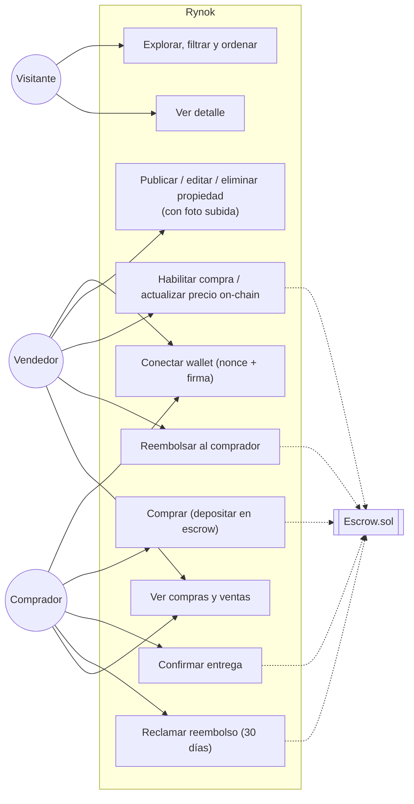
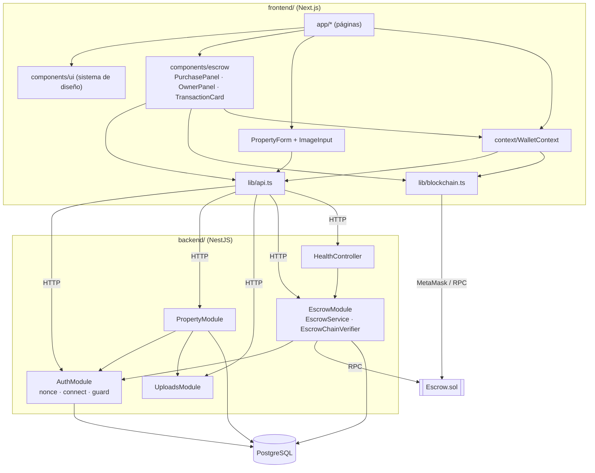
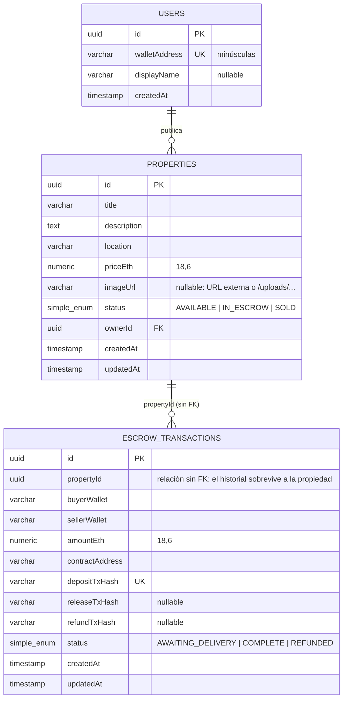
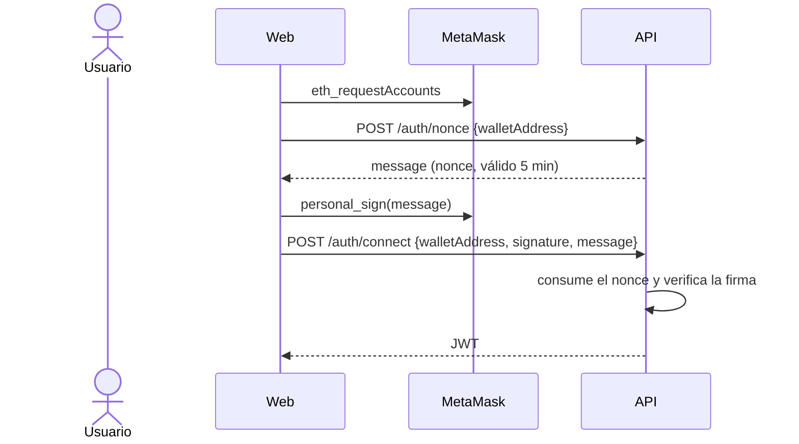
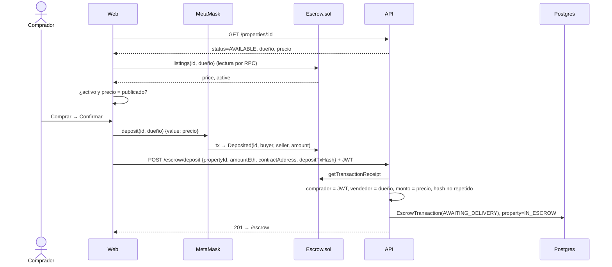
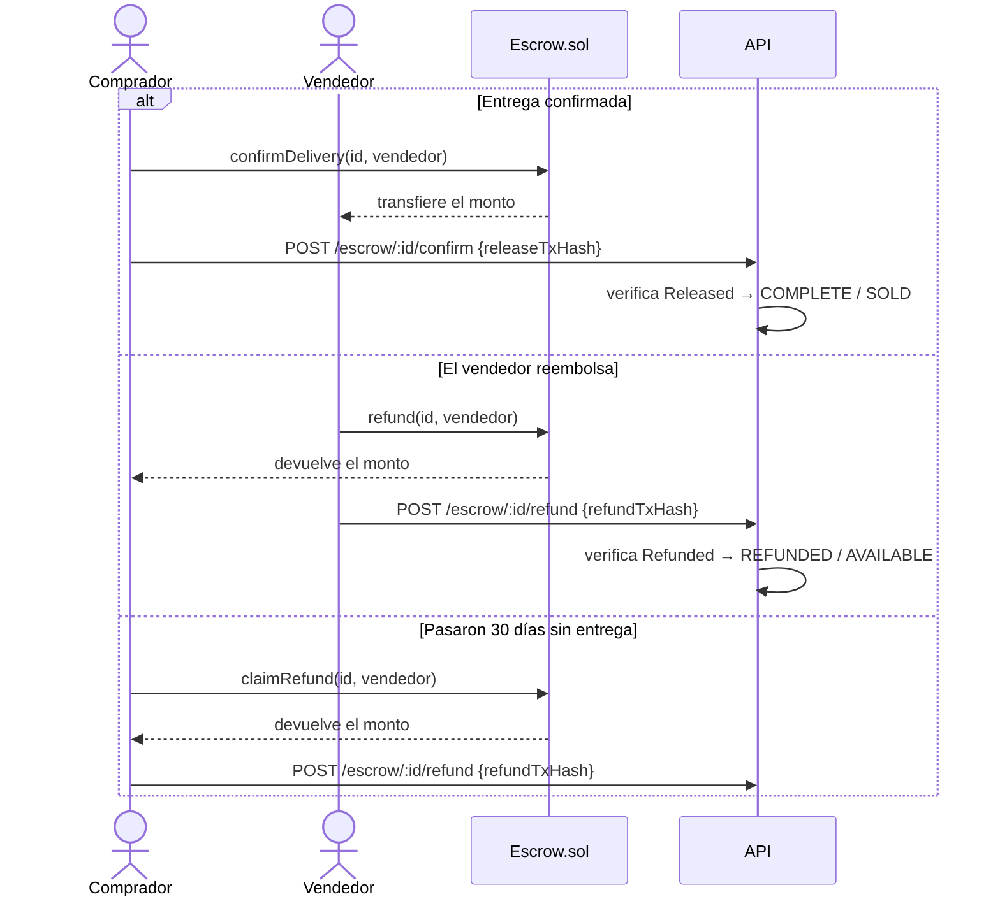

# Diagramas del sistema

Diagramas en Mermaid (GitHub los renderiza), reconciliados con el código actual.

## 1. Casos de uso

## 2. Componentes

## 3. Modelo de datos (ERD)

Estado en cadena (`Escrow.sol`), indexado por `(uint256 propertyId, address seller)`:

- `listings`: `{ price, active }`
- `deals`: `{ buyer, amount, depositedAt, status: NONE | AWAITING_DELIVERY | COMPLETE | REFUNDED }`

## 4. Secuencia: inicio de sesión

## 5. Secuencia: compra protegida

## 6. Secuencia: liquidación

