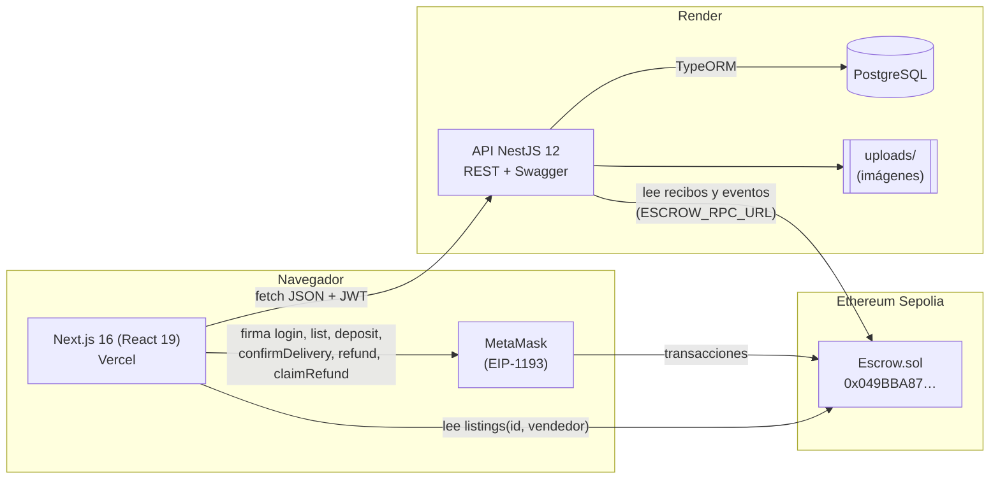
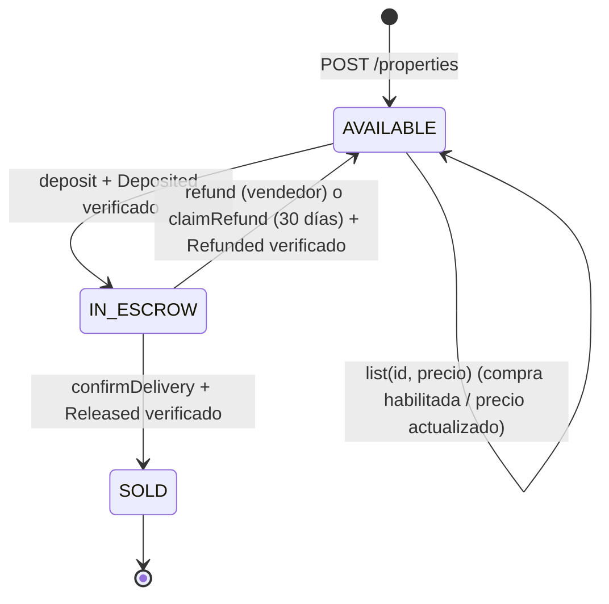

# Arquitectura de Rynok

Documento reconciliado con el código de este repositorio (rama `mejoras-demo-defensa`). Diagramas detallados en [System-Diagrams.md](./System-Diagrams.md); diseño y seguridad del contrato en [escrow.md](./escrow.md).

## 1. Vista general

**Principio central: el contrato custodia el dinero y el backend es un índice verificado.** El navegador envía las transacciones al contrato con MetaMask (el backend nunca tiene claves). Después informa el hash al backend, que lee el recibo en la blockchain y solo cambia estados si el evento emitido coincide con su base de datos: propiedad, comprador, vendedor y monto.

## 2. Módulos

### Contrato (`contracts/`)

- `Escrow.sol`: `list`, `deposit`, `confirmDelivery`, `refund` (vendedor) y `claimRefund` (comprador, tras `DELIVERY_PERIOD = 30 days`). Usa `ReentrancyGuard` de OpenZeppelin.
- Listados y depósitos indexados por `(propertyId, vendedor)`, con `propertyId = uint256(keccak256(uuid))`. Es el mismo cálculo en backend (`escrowPropertyId`) y frontend (`lib/blockchain.ts`).

### Backend (`backend/src`)

| Módulo         | Responsabilidad                                                                                                                                                                        |
| -------------- | -------------------------------------------------------------------------------------------------------------------------------------------------------------------------------------- |
| `auth`         | Login sin contraseña: `POST /auth/nonce` emite un mensaje con nonce de un solo uso (5 min) y `POST /auth/connect` verifica la firma y emite el JWT. Limitado a 10 intentos por minuto. |
| `property`     | CRUD, búsqueda paginada y ordenada en servidor, `GET /properties/mine`, reglas de dueño y de estado                                                                                    |
| `uploads`      | `POST /uploads/images`: valida el tipo por los bytes del archivo (JPG/PNG/WebP/GIF, máx. 5 MB)                                                                                         |
| `escrow`       | `EscrowChainVerifier` (lee recibos y decodifica eventos; fail-closed en producción) + `EscrowService` (estados) + entidad `EscrowTransaction`                                          |
| `health`       | `GET /` (ping para Render) y `GET /health` (estado de la base y de la verificación on-chain)                                                                                           |
| `common`       | Filtro de errores uniforme, logger de peticiones, transformador de decimales                                                                                                           |
| `app.setup.ts` | helmet, CORS (`CORS_ORIGINS`), `trust proxy`, archivos estáticos de `/uploads`, `ValidationPipe` estricto y Swagger; compartido por `main.ts` y las e2e                                |

### Frontend (`frontend/src`)

| Carpeta                 | Contenido                                                                                                                                                               |
| ----------------------- | ----------------------------------------------------------------------------------------------------------------------------------------------------------------------- |
| `app/`                  | Rutas (App Router). Listado y detalle son Server Components; las páginas de cuenta (`dashboard`, `escrow`, `wallet`) son Client Components porque dependen de la wallet |
| `components/ui`         | Sistema de diseño (ver [style_guide.md](./style_guide.md))                                                                                                              |
| `components/escrow`     | `PurchasePanel`, `OwnerPanel`, `TransactionCard`, `TxLink`                                                                                                              |
| `components/`           | `BuyButton`, `PropertyForm` + `ImageInput`, `OnboardingModal`, filtros, paginación                                                                                      |
| `context/WalletContext` | Sesión (`useSyncExternalStore` sobre `sessionStorage`), red, cambio de cuenta y `withSession` (reconexión ante 401)                                                     |
| `lib/api.ts`            | Cliente HTTP tipado con `ApiError` y mensajes en español                                                                                                                |
| `lib/blockchain.ts`     | Red esperada, ABI, lectura sin MetaMask por RPC, transacciones y `describeTxError`                                                                                      |

## 3. Máquina de estados

| Base de datos (`properties.status`)       | Contrato (`listings` / `deals`)         | UI                                                                                    |
| ----------------------------------------- | --------------------------------------- | ------------------------------------------------------------------------------------- |
| `AVAILABLE` sin listado activo            | `listings[id][vendedor].active = false` | El dueño ve "Habilitar compra"; el comprador, "El vendedor aún no habilitó la compra" |
| `AVAILABLE` con precio distinto           | `price ≠ priceEth`                      | El dueño ve "Actualizar precio on-chain"; la compra está bloqueada                    |
| `AVAILABLE` y listado al precio publicado | `active = true`, mismo precio           | El comprador ve "Comprar con MetaMask"                                                |
| `IN_ESCROW`                               | `deals[...].status = AWAITING_DELIVERY` | Acciones en `/escrow`                                                                 |
| `SOLD`                                    | `COMPLETE`                              | "Vendida"                                                                             |

El listado no se guarda en la base de datos: el frontend lo lee del contrato. Así la base no puede quedar desincronizada respecto a esa información. No se puede editar ni eliminar una propiedad con fondos en escrow (409).

## 4. Configuración por entorno

| Variable       | Backend                                                        | Frontend                                                                    |
| -------------- | -------------------------------------------------------------- | --------------------------------------------------------------------------- |
| Red y contrato | `ESCROW_RPC_URL`, `ESCROW_CONTRACT_ADDRESS`                    | `NEXT_PUBLIC_CHAIN_ID`, `NEXT_PUBLIC_ESCROW_ADDRESS`, `NEXT_PUBLIC_RPC_URL` |
| API            | `PORT`, `NODE_ENV`, `CORS_ORIGINS`, `JWT_SECRET`, `UPLOAD_DIR` | `NEXT_PUBLIC_API_URL`, `API_URL_INTERNAL`, `NEXT_PUBLIC_SITE_URL`           |
| Base de datos  | `DATABASE_URL` o `DB_*`, `DB_SSL`, `DB_SYNCHRONIZE`            | —                                                                           |

## 5. Despliegue y calidad

- Render (`render.yaml`) con API y Postgres, y Vercel con la web. `NODE_ENV=production` exige `JWT_SECRET` y la verificación on-chain.
- `docker-compose.yml`: Postgres (5433, healthcheck) y perfil `app` con API y web en contenedores.
- CI (`.github/workflows/ci.yml`): lint, typecheck, contratos, backend, frontend, build y e2e de Playwright.
